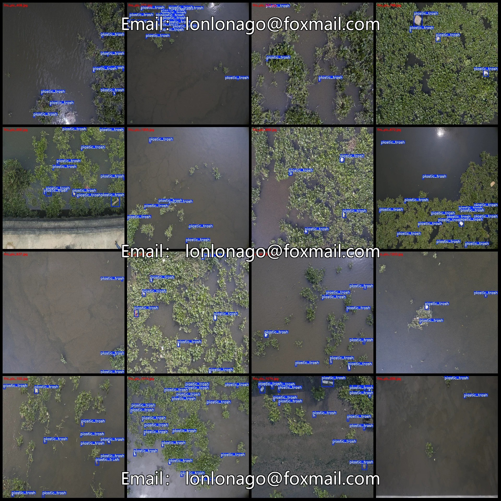
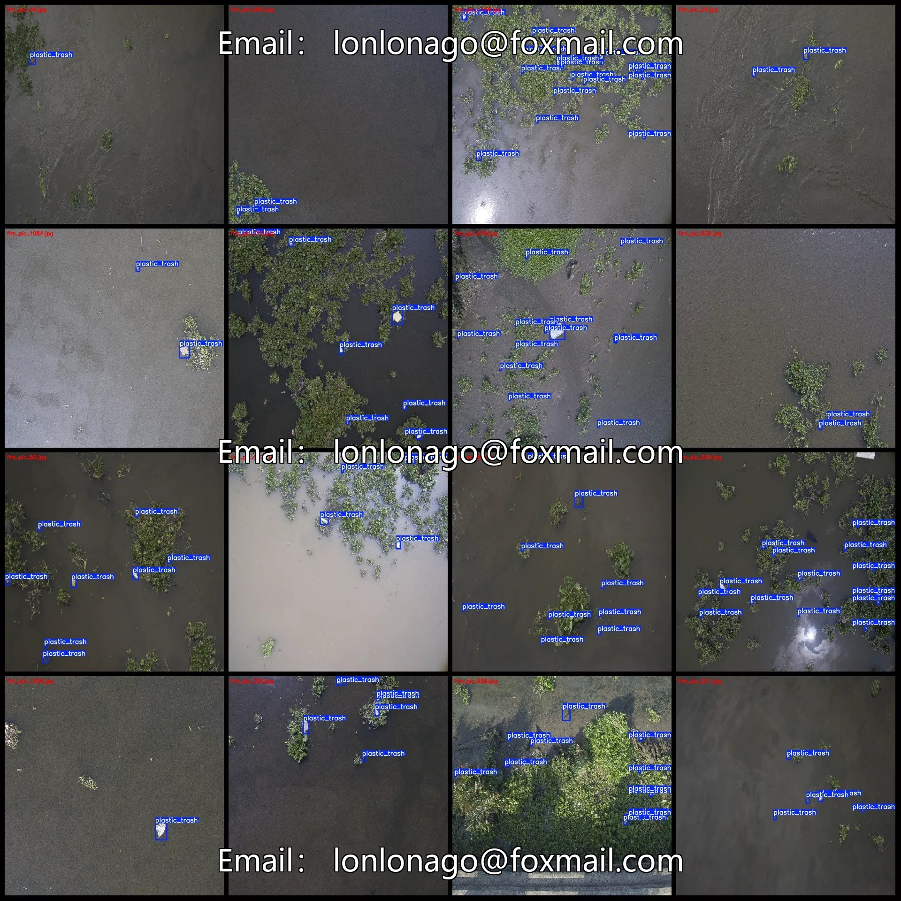
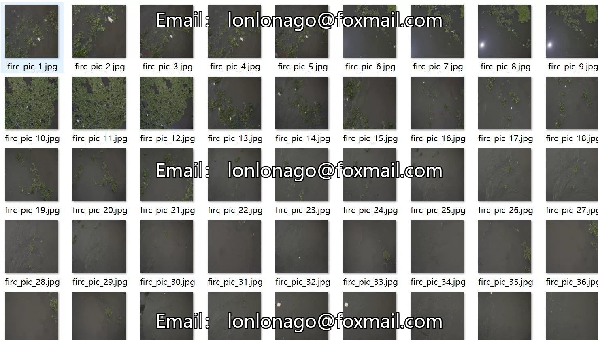
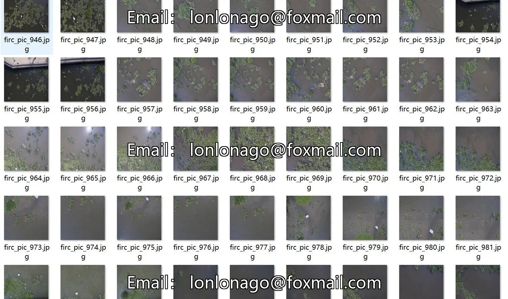
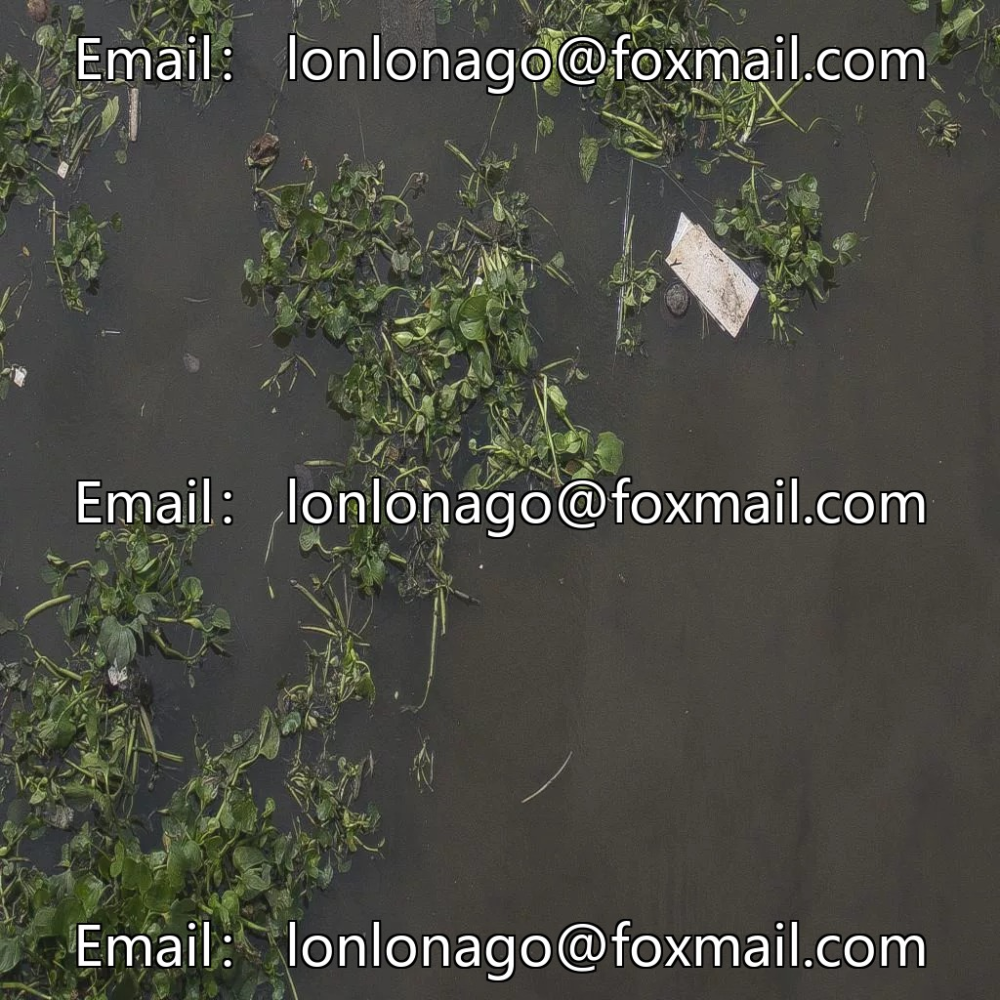
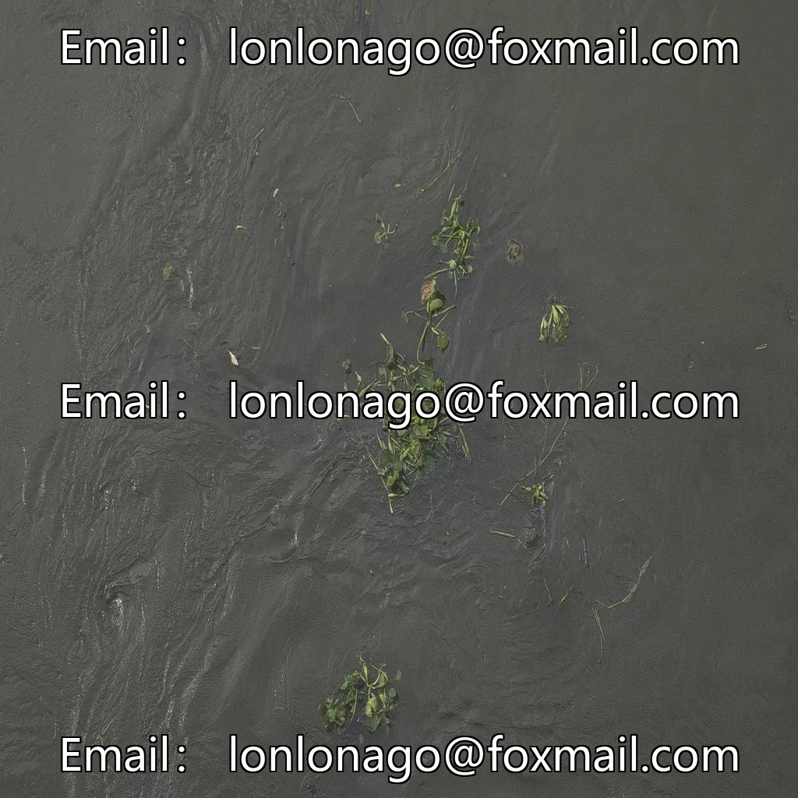
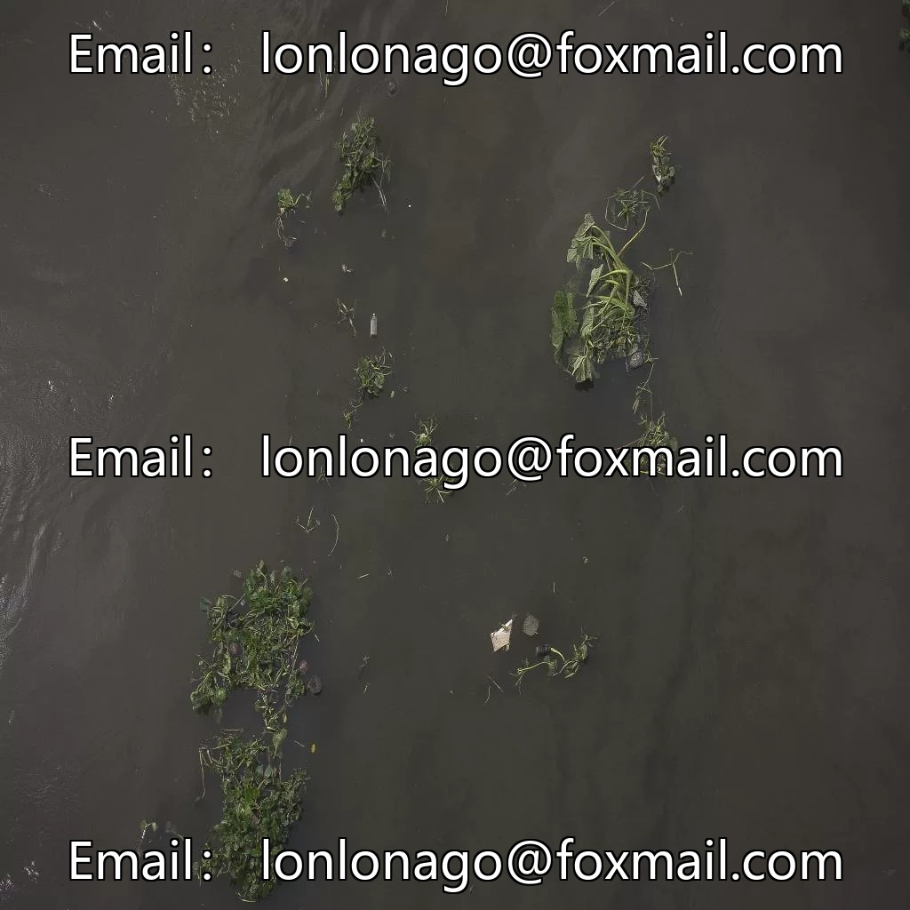

# Drone-view aerial photography dataset of river surface plastic waste detection in VOC+YOLO format

## Body

Drone-Viewpoint Aerial Photography Dataset for River Water Plastic Waste Detection - VOC+YOLO Format: 1320 Images in 1 Category with Enhanced
Warm Reminder: Due to the dataset's replicability, please confirm compliance before purchasing.
Note: The dataset contains extensive enhancements. There are 110 original images and all others have been created by altering brightness contrast, adding noise, rotating, etc.
Dataset Format: Pascal VOC format + YOLO format (txt file without segmentation paths, only containing jpg images along with corresponding VOC format xml files and yolo format txt files)
Number of Images (Total jpg Files): 1320
Number of Annotations (Total xml Files): 1320

Number of annotations (txt file count): 1320
Number of annotation categories: 1
Annotation category names: ["plastic_trash"]
Each category has the following number of bounding boxes and image occupied by each box:
- plastic_trash = 11895, occupied images = 1320
Total number of bounding boxes: 11895
Image resolution: 1024x1024
Annotation tool used: labelImg
Annotation rules: Draw a rectangle around the category.
Important note: The dataset does not have splits for training, validation, or testing; you will need to manually divide it.
Special statement: This dataset does not guarantee any accuracy in the trained models or weight files.

## Images

## Payment

Here is a pay link on Stripe ( https://buy.stripe.com/3cs8yP7sY87d0vu9AB ). Please contact me lonlonago@foxmail.com after funding $89, and I will send you a complete data files , thank you!

